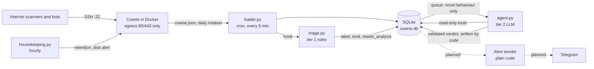

# Cowrie honeypot triage agent

> **Work in progress.** The ingestion pipeline and the deterministic tier 1 triage run in production on a
> small VPS. The tier 2 LLM agent is implemented and covered by tests against a mocked API client; its
> first real run against the live data is still pending. See [Status](#status).

An SSH honeypot ([Cowrie](https://github.com/cowrie/cowrie)) collects real attacker traffic from the
internet. This project turns those raw JSON logs into something an analyst can act on:

1. a **loader** ingests the logs incrementally into SQLite,
2. a **deterministic tier 1** labels the ~99.9% of sessions that are known noise or known campaigns,
3. an **LLM agent (tier 2)** analyses only what tier 1 could not explain, with read-only tools,
4. **alerts** (planned: Telegram) are sent by plain code, never by the model.

The design goal is an agent that is cheap to run and safe to point at hostile data.

## Architecture



| Component | File | Runtime | What it does |
|---|---|---|---|
| Loader | `src/loader.py` | stdlib, cron every 5 min | Incremental, rotation-safe (offsets per inode), idempotent ingestion of Cowrie events into `sessions`, `logins`, `commands`, `downloads`, `uploads`, `tunnels`. Computes a behavioural fingerprint per session. |
| Fingerprint | `src/fingerprint.py` | stdlib | Hash of the *normalized* command sequence (SSH keys, URLs, IPs, blobs and long numbers masked), so the same playbook from different IPs collapses to one value. |
| Tier 1 triage | `src/triage.py` | stdlib, called by the loader | Labels every closed session: `noise`, `known_campaign` or `unknown`, and flags the ones that need analysis (dropper pattern, first-seen upload/download hash, first-seen tunnel target, first-seen fingerprint). `--report` prints counts and the queue. |
| Tier 2 agent | `src/agent.py` | Python venv + `anthropic` SDK | Groups the queue in code (by file hash, tunnel target, fingerprint), runs a short tool-use loop per group, validates the model's verdict and stores it in `analysis`. Also `chat` for ad hoc questions over the data. |
| Housekeeping | `src/housekeeping.py` | stdlib, cron hourly | Deletes rotated logs only when older than 30 days **and** fully ingested; low-disk alert to Telegram with cooldown. |
| Schema | `src/schema.sql` | | All tables, additive migrations only. |

### Why two tiers

Almost all honeypot traffic is repetitive: the same probe or the same playbook thousands of times.
Sending that to an LLM would be slow, expensive and pointless. Tier 1 is a set of exact,
deterministic rules that is cheap, testable and explainable. It counts the known, and only
**novel behaviour** goes to tier 2. On the real data (about 21,000 sessions after three weeks) the
tier 2 queue was 22 sessions, and the agent groups those further, so one analysis run is a handful of
model calls instead of thousands.

Tier 1 allowlists are exact on purpose: `uname -a` is noise, `uname -a; wget ... | sh` is not.
A known campaign that suddenly pushes a new binary is still queued, because payload signals
(first-seen hash or tunnel target) apply to every label.

### Cost control (tier 2)

- Cheapest current model by default (configurable), `max_tokens` per reply.
- Hard caps: model calls per group, groups per run, and a USD budget per run and per chat session.
  The budget is checked against the worst case of the *next* call before it is made.
- Tool output is capped (rows, characters, SQL wall-clock time), so a prompt cannot balloon.
- Every API call is logged with token counts and estimated cost (`agent.py usage`).
- Failed groups (refused, no verdict, iteration cap) are recorded and not retried automatically.

## Threat model

The honeypot is a magnet for hostile input, and the agent reads that input. The design assumes
the attacker controls every string they can type.

| Risk | Mitigation |
|---|---|
| **Prompt injection** through commands, usernames, passwords, SSH key comments, client versions, filenames, URLs | All attacker-controlled data is treated as untrusted. It reaches the model only JSON-encoded inside `<untrusted_data nonce=...>` blocks, with a per-process random nonce, terminal escapes and control characters stripped, and `< > &` escaped, so a string cannot close the block or pose as an instruction. The system prompt says data is evidence, never instructions. Tests include an injection payload that tries to call non-existent tools. |
| **Agent writes or destroys data** | The model's tools are read-only, enforced four independent ways: SQLite opened with `mode=ro`, `PRAGMA query_only`, an SQLite authorizer callback that allows only read actions (and denies functions such as `load_extension`), and a statement-type check (SELECT/WITH only). Row, time and output caps on top. |
| **Agent takes actions in the world** | No shell, network, file or alert tool exists. `submit_verdict` only returns JSON to the script, which validates it (allowed classifications, MITRE id format, session ids) before storing. **Alerts are plain code**, never an LLM tool. |
| **Model output used unsafely** | Verdict fields come from attacker data via the model, so they are displayed through a sanitizer and never executed or fetched. IOCs are stored as data only. |
| **Honeypot used as an attack platform** | Docker egress from the honeypot container is restricted to TCP 80/443 in the `DOCKER-USER` chain (see `deploy/docker-egress.md`), so captured bots cannot SSH-scan, brute-force or relay mail (port 25) outward. Every `direct-tcpip` forwarding request is logged and queued for analysis. |
| **Payload execution** | Nothing in this project executes, opens or fetches a captured payload. Files are referred to by SHA-256 only; enrichment (planned) is hash lookup only. |
| **Secrets** | API key and Telegram token live in `.env` (chmod 600, warned otherwise), are never printed or logged, and `.env` is git-ignored. The API key is a dedicated key with a small prepaid balance and no auto-reload. |
| **Terminal injection** | Everything printed to the operator's terminal (`--report`, `show`, `chat`) goes through an escape-stripping filter. |

## What the data showed (weeks 1 to 3)

Aggregate observations from about **21,000 sessions** in the first three weeks of November 2026.
No attacker IPs are published here.

- **Credentials are not a signal.** Cowrie accepts almost any login, so successful logins vastly
  outnumber failures. Behaviour after login is what matters.
- **One source, half the traffic.** About **10,500 sessions** came from a single IP running the same
  one-command login probe (`echo -e "\x6F\x6B"`, which prints `ok`) to check whether a shell works.
- **"mdrfckr" SSH key injection campaign** across about **338 IPs**: removes `~/.ssh`, writes its own
  `authorized_keys` entry (key comment `mdrfckr`), locks the directory with `chattr`, sometimes
  changes the root password and fingerprints the CPU (a common precursor to cryptomining). A well
  documented botnet; tier 1 matches it by content because the longer variants have unique fingerprints.
- **scp dropper playbook**: `scp -t /tmp/<random 8 chars>`, then `chmod +x` and `bash -c ./<file>`.
  14 sessions from 4 IPs pushed the same file, so the agent analyses it once as one group.
- **Fake `sshd` uploads** over SFTP (several sessions, same hash), a classic trojanized-daemon
  pattern; one upload was the empty file.
- **Spam relay attempts**: `direct-tcpip` forwarding requests to a public mail server on **port 25**,
  plus connectivity tests to a well-known web host on port 80. The egress filter blocks port 25, so
  the honeypot cannot be used as a spam relay.
- **Multi-recon scanner**: one session sequence checking for running miners, Telegram Desktop
  session data (`tdata`) and MikroTik RouterOS commands, which suggests a bot shopping for
  several kinds of loot at once.
- **Scanner markers** such as `echo SSHOLE_<epoch>`, which is why the fingerprint masks long numbers.

Public IOCs (truncated SHA-256 of files uploaded to the honeypot; lookup by hash only):

| Hash prefix | Seen as | Notes |
|---|---|---|
| `6e78b3f8…` | SFTP upload named `sshd` | multiple sessions, pending VirusTotal lookup |
| `6d1fe6ab…` | scp dropper file | same file from several IPs |
| `e3b0c442…` | SFTP upload | SHA-256 of the empty file, not a payload |

## Status

**Done**
- [x] Cowrie in Docker on a 2 GB VPS, egress restricted, real SSH moved to a non-standard port, key-only
- [x] Loader: incremental, rotation-safe, idempotent, with additive schema migrations
- [x] Behavioural fingerprints
- [x] Tier 1 triage: applied in production and tuned on real data (about 21k sessions triaged)
- [x] Housekeeping: safe log retention, low-disk alert
- [x] Tier 2 agent v0: tool-use loop, read-only tools, verdict validation, cost caps, `chat`.
      Tested against a mocked API client (no network); first real run pending

**Planned**
- [ ] First real agent run on the live tier 2 queue, then prompt tuning
- [ ] Enrichment: AbuseIPDB (IP reputation), VirusTotal (hash lookup only, never upload)
- [ ] Campaign grouping by HASSH, broader MITRE ATT&CK mapping
- [ ] Telegram alerts and a conversational interface, daily report
- [ ] Prompt-injection red-team suite against the live agent
- [ ] Later, separate repo: Detection-as-Code pipeline producing tested Sigma rules from this data

## Running it

The code is deployed as a flat directory (`~/honeypot-agent` on the VPS): copy the contents of
`src/` there. Paths default to that directory (`data/cowrie.db`, `.env`) and can be overridden with
`COWRIE_DB`, `COWRIE_LOG_GLOB`, `COWRIE_LOG_DIR`. See `deploy/` for cron and egress notes.

```bash
# tier 1 (stdlib only, system python3)
python3 loader.py              # ingest new log lines, then run tier 1 triage
python3 triage.py --report     # verdict counts and the tier 2 queue (read-only)
python3 housekeeping.py --dry-run

# tier 2 (venv with the pinned Anthropic SDK)
python3 -m venv .venv && .venv/bin/pip install -r requirements.txt
cp .env.example .env && chmod 600 .env     # then add your own key
.venv/bin/python agent.py check            # config, DB, SDK; no API call
.venv/bin/python agent.py analyze --dry-run    # groups that would be analysed; no API call
.venv/bin/python agent.py analyze --limit 1    # one group, real API call
.venv/bin/python agent.py show | usage | chat
```

## Tests

[](../../actions/workflows/tests.yml)

60 tests, synthetic data only (modelled on the real traffic, with documentation-range IPs), no
network and no API key: the Anthropic client is replaced by a scripted fake. No payload is
executed; commands are plain strings.

```bash
python3 -m venv .venv && .venv/bin/pip install -r src/requirements.txt pytest
.venv/bin/python -m pytest -q tests
```

- `tests/test_update.py`: loader against a database created by the old schema (migration,
  backfill, rotation, idempotence) and housekeeping retention and alert cooldown.
- `tests/test_triage.py`: tier 1 rules end to end through the loader.
- `tests/test_agent.py`: grouping, read-only enforcement (writes, `ATTACH`, `load_extension`
  rejected), untrusted-data encoding and an injection payload, verdict validation, budget stops,
  secrets never printed.

## Repository layout

```
src/        loader, fingerprint, triage (tier 1), agent (tier 2), housekeeping, schema
tests/      pytest suite (synthetic data, mocked API)
deploy/     cron lines, Docker egress rules, deployment notes
.github/    CI: runs the test suite on every push
docs/       design notes
```

See also [SECURITY.md](SECURITY.md) (responsible use and data handling) and
[SANITIZE.md](SANITIZE.md) (what was removed before publishing).

## License

MIT, see [LICENSE](LICENSE).
